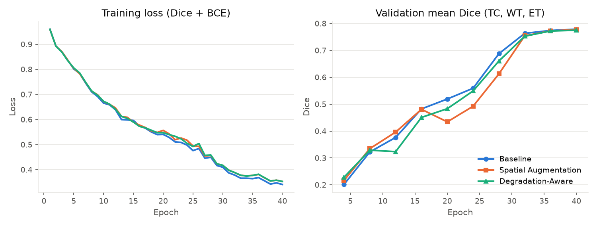
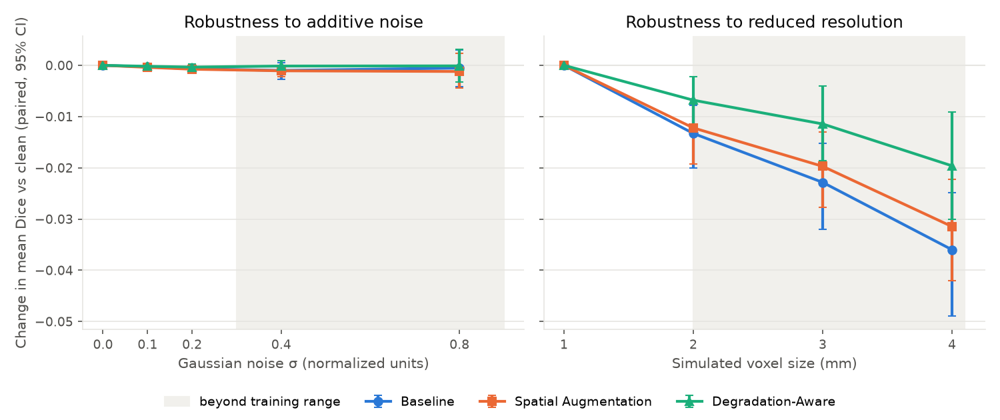
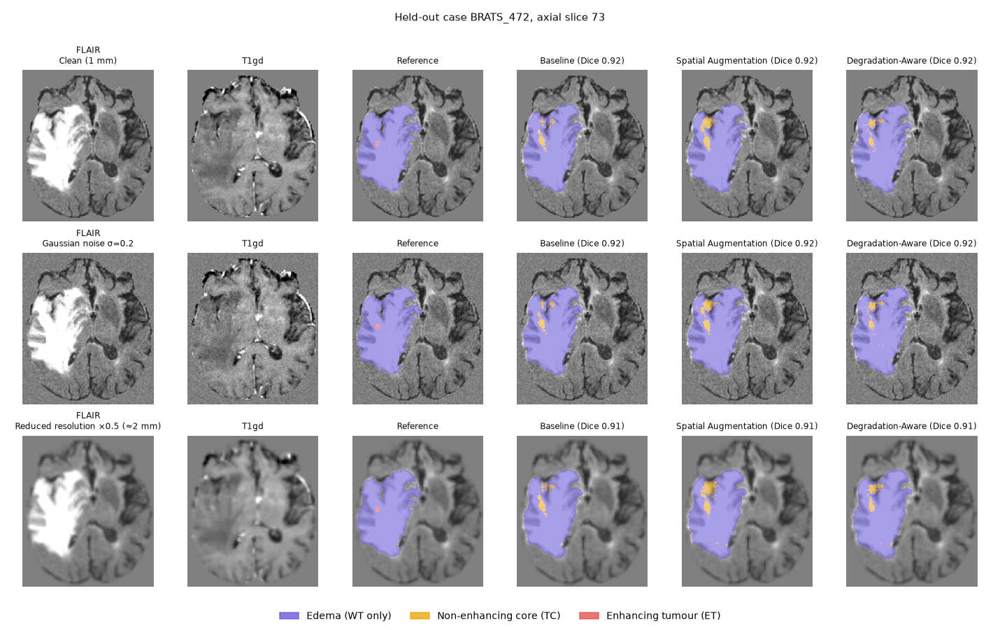

# MedImageLab
### Deep Learning for Medical Image Analysis

MedImageLab is a Python-based biomedical engineering project focused on applying deep learning to medical image processing, anatomical segmentation, and computational imaging research.

The project explores how neural networks can analyze complex medical imaging data, identify anatomical structures, and produce quantitative predictions from MRI and other medical scans.

Built on the open-source MONAI framework, MedImageLab focuses on reproducible model development, imaging preprocessing, experimental evaluation, and visualization of medical image predictions.

> **Status:** Research and development  
> **Application:** Biomedical Engineering / Medical Imaging  
> **Clinical Use:** Research only. Not intended for medical diagnosis.

---

## Overview

Medical image analysis presents several computational challenges, including high-dimensional data, anatomical variability, inconsistent imaging conditions, and limited annotated datasets.

MedImageLab investigates these challenges by developing and evaluating deep learning workflows for medical image analysis.

The project is organized around five research areas:

1. **Image Preprocessing:** Preparing medical scans for neural network training through normalization, spatial transformations, and augmentation.
2. **Anatomical Segmentation:** Investigating models that identify and separate anatomical structures within medical images.
3. **Model Training:** Experimenting with neural network architectures and training configurations.
4. **Quantitative Evaluation:** Measuring prediction accuracy, spatial agreement, and computational performance.
5. **Visualization:** Examining model outputs, anatomical predictions, and segmentation errors.

## Research Objectives

The primary objectives are to:

- Investigate deep learning methods for biomedical image analysis.
- Evaluate 2D and 3D medical image segmentation approaches.
- Examine how preprocessing and augmentation affect model performance.
- Compare model predictions against annotated reference images.
- Study the effects of image resolution, noise, and anatomical variation.
- Identify prediction failures and potential sources of error.
- Develop reproducible experimental workflows.

---

## Technical Architecture

The research workflow is organized into five stages.

```text
           MEDICAL IMAGING DATA
                    |
                    v
           DATA PREPROCESSING
       Normalization / Resampling
          Cropping / Augmentation
                    |
                    v
             MODEL TRAINING
          Deep Neural Networks
                    |
                    v
             MODEL INFERENCE
        Anatomical Predictions
                    |
                    v
          QUANTITATIVE ANALYSIS
       Dice / HD95 / Error Analysis
                    |
                    v
          RESULTS & VISUALIZATION
```

## Methodology

### 1. Medical Image Preprocessing

Medical imaging datasets require consistent preprocessing before model training.

The preprocessing workflow used in the brain MRI study:

- Reorientation of every volume to RAS
- Cropping to the brain bounding box (non-zero voxels)
- Per-modality z-score intensity normalization over brain voxels
- Conversion of the integer label map to the nested BraTS regions
- Foreground-biased random patch extraction during training
- Fixed training, validation, and held-out test splits

These operations reduce unwanted variation while preserving relevant anatomical information.

### 2. Deep Learning Models

| Component | Implementation |
|---|---|
| Primary architecture | 3D U-Net (MONAI `UNet`, residual units, instance normalization, 4.8 M parameters) |
| Imaging modality | Multi-parametric MRI (FLAIR, T1w, T1gd, T2w) |
| Target anatomy | Glioma sub-regions: whole tumour, tumour core, enhancing tumour |
| Training framework | PyTorch 2.14 + MONAI 1.6 |
| Input dimensions | 3D, 64 × 64 × 64 training patches (centre of augmented 80³ crops), four input channels; whole-volume sliding-window inference |
| Loss function | Dice + binary cross-entropy (multi-label, sigmoid) |
| Optimization algorithm | Adam, lr 5e-4, weight decay 1e-5, cosine annealing |

### 3. Training

Model training experiments examine how the training configuration influences performance.

Experimental variables in this study:

- Data augmentation (none, spatial, spatial + image degradation)

Held fixed across all configurations:

- Architecture, loss, optimizer, learning-rate schedule
- Number of epochs, batch size, patches per case
- Training, validation, and test cases
- Random seed

Training and validation performance are recorded for every epoch in `history.json` files produced by the training script.

### 4. Quantitative Evaluation

Model predictions are evaluated with standard medical imaging metrics.

| Metric | Description |
|---|---|
| Dice Similarity Coefficient | Overlap between predicted and reference segmentation masks (BraTS convention: empty-vs-empty = 1) |
| 95th-percentile Hausdorff Distance | Discrepancy between predicted and reference region boundaries, in voxels |
| Inference Time | Wall-clock time of whole-volume sliding-window inference per case |

Evaluation uses 30 held-out cases that were not used for model training or checkpoint selection.

### 5. Visualization and Error Analysis

The visualization workflow examines predicted structures and model behavior.

Outputs produced by `experiments/brats_robustness/report.py`:

- Training and validation curves
- Dice as a function of noise level and voxel size
- Segmentation overlays for one held-out case under clean, noisy, and low-resolution input
- Markdown tables with paired bootstrap confidence intervals

---

## Experimental Results

### Brain MRI Segmentation Study

This study measures how training-time data augmentation affects a 3D U-Net that segments glioma sub-regions from multi-parametric MRI, and whether it changes the model's sensitivity to degraded image quality.

The experiment uses the Medical Segmentation Decathlon Task01 BrainTumour dataset, derived from BraTS 2016/17. Each case has four co-registered MRI sequences at 1 mm isotropic resolution:

- FLAIR
- T1-weighted (T1w)
- Contrast-enhanced T1-weighted (T1gd)
- T2-weighted (T2w)

The three segmentation targets are the standard nested BraTS regions:

1. Whole tumour (WT): edema + non-enhancing core + enhancing tumour
2. Tumour core (TC): non-enhancing core + enhancing tumour
3. Enhancing tumour (ET)

Label definitions follow the dataset's own `dataset.json` (1 = edema, 2 = non-enhancing tumour, 3 = enhancing tumour). This was verified empirically: voxels labelled 3 have a mean normalized T1gd intensity of +2.21 versus −0.03 for label 2, as expected for contrast enhancement.

All code, per-case results, and figures are in [`experiments/brats_robustness/`](experiments/brats_robustness/). The complete protocol is documented in that directory's README.

### Experimental Design

Of the 484 labelled cases, 145 were drawn once with a fixed seed: 100 for training, 15 for validation (checkpoint selection), and 30 held out for testing. Three models were trained with an identical budget (40 epochs × 400 patches of 64³ voxels, batch 2, Adam, cosine schedule, batch Dice + BCE loss) and an identical seed. Only the augmentation differs, forming an additive ladder:

| Experiment | Training augmentation | Best validation mean Dice |
|---|---|---|
| Baseline | foreground-biased random crops only | 0.779 |
| Spatial Augmentation | + random affine (±15° rotation, ±10% scaling) and random flips | 0.777 |
| Degradation-Aware Training | + Gaussian noise (σ up to 0.3) and simulated low resolution (down to 2 mm) | 0.775 |

The whole study ran on one Apple M3 laptop (16 GB, PyTorch MPS backend): about 47 minutes of training per model and 3 s of sliding-window inference per case.



### Robustness Evaluation

Every model was evaluated on the same 30 held-out cases under clean input and under two synthetic degradations applied to the normalized test volumes, with a fixed noise pattern per case so that the comparison is paired:

- Gaussian noise with σ = 0.1, 0.2, 0.4, and 0.8 on the normalized intensity scale (σ = 0.2 means 20% of the within-brain intensity standard deviation).
- Resolution reduction to ≈2 mm, ≈3 mm, and ≈4 mm voxels (area downsampling followed by trilinear upsampling back to the 1 mm grid), scored against the original 1 mm reference labels.

Levels above σ = 0.3 or coarser than 2 mm lie outside the degradation-aware model's training range.

**Headline: mean Dice over TC, WT, and ET (30 test cases)**

| Model | Clean MRI | Noisy MRI (σ = 0.2) | Reduced resolution (2 mm) | Δ noise | Δ 2 mm |
|---|---|---|---|---|---|
| Baseline | 0.752 | 0.751 | 0.738 | −0.001 | −0.013 |
| Spatial Augmentation | 0.745 | 0.744 | 0.732 | −0.001 | −0.012 |
| Degradation-Aware Training | 0.739 | 0.738 | 0.732 | −0.000 | −0.007 |

**Full degradation sweep: mean Dice (mean ± std across cases)**

| Condition | Baseline | Spatial Augmentation | Degradation-Aware |
|---|---|---|---|
| Clean (1 mm) | 0.752 ± 0.164 | 0.745 ± 0.170 | 0.739 ± 0.180 |
| Noise σ = 0.1 | 0.751 ± 0.164 | 0.744 ± 0.170 | 0.739 ± 0.180 |
| Noise σ = 0.2 | 0.751 ± 0.165 | 0.744 ± 0.170 | 0.738 ± 0.180 |
| Noise σ = 0.4 (beyond training range) | 0.751 ± 0.165 | 0.744 ± 0.171 | 0.739 ± 0.179 |
| Noise σ = 0.8 (beyond training range) | 0.751 ± 0.163 | 0.744 ± 0.169 | 0.739 ± 0.176 |
| Resolution ≈2 mm | 0.738 ± 0.171 | 0.732 ± 0.177 | 0.732 ± 0.183 |
| Resolution ≈3 mm (beyond training range) | 0.729 ± 0.171 | 0.725 ± 0.177 | 0.727 ± 0.180 |
| Resolution ≈4 mm (beyond training range) | 0.716 ± 0.174 | 0.713 ± 0.179 | 0.719 ± 0.180 |



**Clean-image accuracy per region**

| Model | Dice WT | Dice TC | Dice ET | HD95 WT (vox) | HD95 TC (vox) | HD95 ET (vox) |
|---|---|---|---|---|---|---|
| Baseline | 0.797 ± 0.185 | 0.733 ± 0.186 | 0.724 ± 0.226 | 37.0 | 28.2 | 24.7 |
| Spatial Augmentation | 0.784 ± 0.200 | 0.732 ± 0.188 | 0.717 ± 0.227 | 38.7 | 26.6 | 21.4 |
| Degradation-Aware Training | 0.786 ± 0.204 | 0.725 ± 0.195 | 0.706 ± 0.237 | 40.9 | 29.0 | 26.3 |

HD95 is the 95th-percentile Hausdorff distance in voxels, averaged over the cases where the reference and all three predictions are non-empty (30 cases for WT and TC, 29 for ET because one test case has no enhancing tumour). No model missed a structure entirely.

**Paired differences in mean Dice (95% bootstrap CI over cases)**

| Condition | Spatial − Baseline | Degradation-Aware − Spatial | Degradation-Aware − Baseline |
|---|---|---|---|
| Clean | −0.007 [−0.015, +0.001] | −0.006 [−0.015, +0.002] | −0.013 [−0.027, +0.000] |
| Noise σ = 0.2 | −0.007 [−0.015, +0.001] | −0.006 [−0.015, +0.002] | −0.012 [−0.027, +0.000] |
| Noise σ = 0.8 | −0.007 [−0.017, +0.002] | −0.005 [−0.012, +0.002] | −0.012 [−0.025, −0.001] |
| Resolution ≈2 mm | −0.006 [−0.013, +0.001] | −0.001 [−0.009, +0.008] | −0.006 [−0.020, +0.006] |
| Resolution ≈3 mm | −0.004 [−0.010, +0.002] | +0.002 [−0.007, +0.011] | −0.001 [−0.014, +0.010] |
| Resolution ≈4 mm | −0.002 [−0.009, +0.004] | +0.006 [−0.003, +0.015] | +0.004 [−0.010, +0.016] |

The full table for every condition is in [`results/summary_tables.md`](experiments/brats_robustness/results/summary_tables.md); per-case values are in [`results/per_case_results.csv`](experiments/brats_robustness/results/per_case_results.csv).



### Analysis

**1. Clean-image accuracy.** The baseline reached the highest clean test Dice (0.752), with spatial augmentation 0.007 lower and degradation-aware training 0.013 lower. None of these differences is distinguishable from case-to-case variation with 30 test cases, and the validation curves show why: the augmented models lag in the middle of the schedule and only catch up in the final cosine-annealed epochs. With training loss still falling and validation Dice still rising at epoch 40, the models are not yet overfitting, so augmentation has had no overfitting to prevent. The projected ordering in the original proposal (augmentation improving clean Dice) did not materialise within this budget.

**2. Additive Gaussian noise.** Additive independent Gaussian noise had no measurable effect on any model. Mean Dice changed by at most 0.001 even at σ = 0.8, which is 80% of the within-brain intensity standard deviation and far outside the degradation-aware training range. The predictions do change (on the illustrated case about 7,000 of 161,000 whole-tumour voxels flip at σ = 0.8), but the flips are confined to the boundary and cancel out: per-case changes range from −0.02 to +0.02 Dice. Two factors explain this. Tumour contrast is large relative to the noise (on the illustrated case FLAIR inside the whole tumour averages +2.0 standard deviations against −0.3 in healthy brain), and the 3 × 3 × 3 convolutions and repeated downsampling of a U-Net average independent voxel noise away before it reaches a decision. The proposal's projected drop of 0.116 Dice under noise did not occur, so noise augmentation bought nothing here. The one paired interval that excludes zero (degradation-aware minus baseline at σ = 0.8) simply carries the clean-image gap through unchanged.

**3. Reduced resolution.** Resolution loss is the degradation that matters. The baseline loses 0.013 Dice at 2 mm and 0.023 at 3 mm; the degradation-aware model loses 0.007 and 0.012. At 4 mm the gap widens further: the baseline loses 0.036 and the spatial model 0.032, while the degradation-aware model loses 0.020 and becomes the most accurate of the three (0.719 versus 0.716) despite starting 0.013 lower. The pattern is the one hypothesised in the proposal, a trade of clean accuracy for stability, but it is small: at 3 mm all three models sit within 0.004 Dice of one another, and every paired confidence interval at the reduced-resolution levels includes zero.

**4. Anatomical boundary accuracy.** HD95 values of 20–40 voxels for every model are large relative to the Dice scores. The overlay figure shows the cause: predictions are compact and accurate around the tumour, but small false-positive islands (notably tumour-core specks inside edema and stray fragments elsewhere) sit far from the reference boundary and dominate the 95th-percentile distance. Connected-component post-processing would likely improve HD95 far more than any of the augmentation choices tested here.

**5. Limitations.** Every number comes from a single training seed; run-to-run variation of a 40-epoch, 100-case training is probably comparable to the differences observed, so none of the orderings above should be read as established. The models are also under-trained relative to full BraTS pipelines (WT Dice 0.80 versus about 0.90 for mature systems), the 64³ patches and 40-epoch budget were dictated by laptop hardware, and the degradations are synthetic. The paired confidence intervals are not corrected for multiple comparisons, and training on the MPS backend is not bitwise reproducible.

### Research Implications

The proposal assumed that a model trained on clean images would be fragile under noise and that augmentation would trade clean accuracy for robustness. The measured outcome is more nuanced: the architecture itself already provides noise robustness at realistic levels, the resolution trade-off exists but is small, and the dominant error mode (distant false positives) is not addressed by augmentation at all. Evaluating only on clean validation data would have missed none of the Dice ordering but would also have hidden how little the degradations matter relative to seed variance and post-processing.

Natural next steps are to train 3 seeds per configuration so the comparison can be bootstrapped over training runs as well as cases, to add connected-component filtering and re-measure HD95, and to extend the sweep to structured degradations (Rician noise, motion ghosting, bias fields) that are harder for convolutions to average away.

---

## Technologies

| Technology | Application |
|---|---|
| Python 3.12 | Development and experimentation |
| PyTorch 2.14 (MPS backend) | Deep learning |
| MONAI 1.6 | 3D U-Net, transforms, sliding-window inference, Hausdorff distance |
| NumPy / SciPy | Numerical computation and bootstrap statistics |
| NiBabel | NIfTI loading and reorientation |
| pandas | Result tables |
| Matplotlib | Figures |
| pytest | Unit tests for metrics, degradations, label mapping, and transforms |

---

## Repository Structure

```text
brain-mri/
|
├── README.md
├── requirements.txt
|
├── experiments/
|   └── brats_robustness/        # the brain MRI study (code, tests, results)
|       ├── README.md            # full protocol and reproduction steps
|       ├── prepare_data.py      # extract, split, preprocess
|       ├── transforms.py        # the three augmentation pipelines
|       ├── train.py             # train one configuration
|       ├── evaluate.py          # paired robustness evaluation
|       ├── report.py            # tables, bootstrap CIs, figures
|       ├── degradations.py / metrics.py / model.py / common.py
|       ├── tests/
|       ├── results/             # per-case CSV, summary JSON, tables, figures
|       └── run_all.sh
|
├── data/                        # git-ignored: raw tarball, preprocessed .npy, checkpoints
|
└── 2d_*/ 3d_*/ acceleration/ active_learning/ auto3dseg/ automl/
    # reference notebooks and scripts from the MONAI tutorials collection
```

---

## Installation

Clone the repository:

```bash
git clone https://github.com/27jackson08/brain-mri.git
cd brain-mri
```

Create a virtual environment and install dependencies:

```bash
python -m venv .venv
source .venv/bin/activate      # Windows: .venv\Scripts\activate
pip install -r requirements.txt
```

Download the dataset and run the study:

```bash
mkdir -p data/raw
curl -o data/raw/Task01_BrainTumour.tar \
  https://msd-for-monai.s3-us-west-2.amazonaws.com/Task01_BrainTumour.tar

cd experiments/brats_robustness
python -m pytest tests -q
bash run_all.sh 40 0
```

## Datasets

| Item | Detail |
|---|---|
| Name and source | Medical Segmentation Decathlon, Task01 BrainTumour ([MSD](http://medicaldecathlon.com/)), derived from BraTS 2016/17 |
| Imaging modality | Multi-parametric MRI: FLAIR, T1w, T1gd, T2w; 240 × 240 × 155 voxels at 1 mm isotropic |
| Number of samples | 484 labelled training cases (266 unlabelled test cases are not used) |
| Target structures | Edema, non-enhancing tumour core, enhancing tumour, evaluated as WT / TC / ET |
| Annotations | Expert voxel-wise labels distributed with the dataset |
| Splits used here | 100 train / 15 validation / 30 test, drawn with seed 0; case IDs in `data/preprocessed/split.json` after preprocessing |
| License | CC-BY-SA 4.0 |

No patient-identifiable information is involved; the data are de-identified research scans and are not committed to this repository.

---

## Limitations

Medical image analysis systems are sensitive to image quality, anatomical variability, training data composition, and differences between imaging systems.

Performance on a research dataset does not demonstrate clinical reliability. Specific to this study:

- A single training seed per configuration
- 100 training cases and a 40-epoch budget sized for a laptop GPU
- Synthetic rather than scanner-derived degradations
- Small false-positive islands that inflate boundary distances
- Evaluation on one benchmark dataset and one anatomy

This project is intended for biomedical engineering research and educational experimentation. It is not validated for clinical decision-making.

---

## References and Acknowledgments

This project draws on open-source research in deep learning and computational medical imaging.

- [MONAI Framework](https://github.com/Project-MONAI/MONAI)
- [MONAI Tutorials](https://github.com/Project-MONAI/tutorials)
- [PyTorch](https://github.com/pytorch/pytorch)
- Antonelli, M. et al. *The Medical Segmentation Decathlon.* Nature Communications 13, 4128 (2022).
- Menze, B. H. et al. *The Multimodal Brain Tumor Image Segmentation Benchmark (BRATS).* IEEE TMI 34(10), 1993–2024 (2015).
